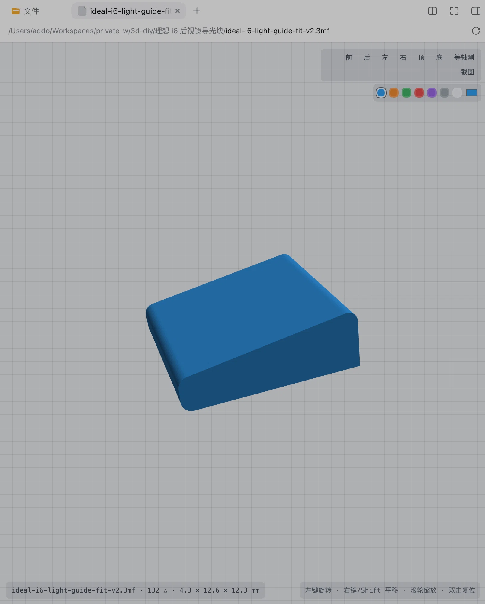

# 3D Model Viewer · STL / 3MF

View 3D-printing models right inside the DeepSeek Harness Web GUI: click a `.stl` / `.3mf` in the Files panel and a 3D view opens as a document tab, exactly like Markdown; when a session references models, a live preview drawer tracks them and re-parses about 1.5s after each on-disk change — no external tools, and model files never leave your machine.

**If it works for you, please [star the repo](https://github.com/addozhang/dsh-3d-model-viewer)** — that directly decides how fast this plugin evolves.

## Highlights

- **Native sidebar preview** — click to open in the Files panel; the same document-tab experience as Markdown / PDF / images
- **Live session drawer** — a `3D Preview (N)` button on the session header opens a searchable drawer; on-disk changes re-parse in ~1.5s
- **CAD navigation** — true trackball rotation (no gimbal lock), pan, zoom, double-click reset; `1-7` view presets, `R` to reset
- **Orthographic dimension labels** — the six orthographic views show bounding-box XYZ dimensions in mm; isometric stays classic perspective
- **3MF plates & part colors** — Bambu plate-table projects get an `All | Plate N…` toolbar; `basematerials` part colors render per-vertex
- **Fully local** — all parsing happens in the browser, model files never leave the machine; plus one-click PNG snapshot export

## Quick start

1. Install: `dsh plugin --profile <profile> add @addozhang/dsh-3d-model-viewer`
2. Restart that profile and click any `.stl` / `.3mf` in the Files panel

## Links

- Source & docs: <https://github.com/addozhang/dsh-3d-model-viewer>
- Issues: <https://github.com/addozhang/dsh-3d-model-viewer/issues>
- npm package: <https://www.npmjs.com/package/@addozhang/dsh-3d-model-viewer>

---

Finding it useful? [Leave a Star](https://github.com/addozhang/dsh-3d-model-viewer/stargazers) so I know it helped 🙌
