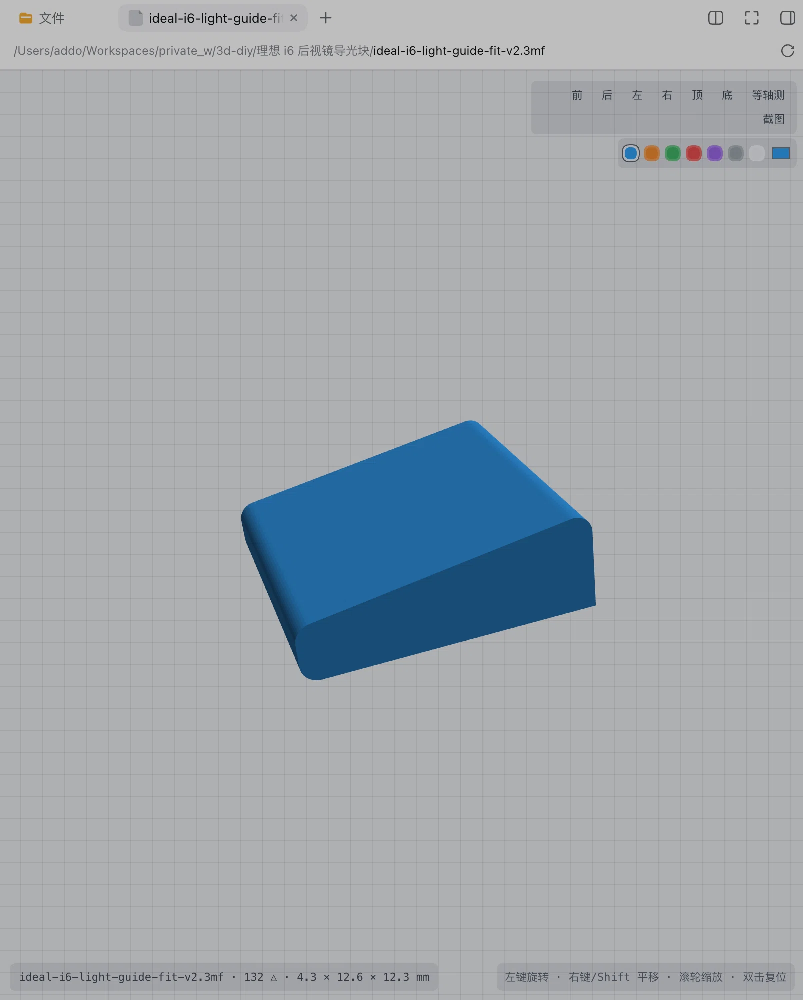

# 3D 模型查看器 · STL / 3MF

在 DeepSeek Harness 的 Web GUI 里直接看 3D 打印模型：文件面板点开 `.stl` / `.3mf`，右侧文档标签页像打开 Markdown 一样打开 3D 视图；会话引用了模型时还有实时预览抽屉，文件一变约 1.5 秒自动刷新——全程无需外部工具，模型文件不出本机。

**好用的话，欢迎去 [GitHub 仓库](https://github.com/addozhang/dsh-3d-model-viewer) 点个 ⭐ Star**——这直接决定这个插件的迭代速度。

## 亮点

- **侧边栏原生预览** — 文件面板点击即开，和 Markdown / PDF / 图片同一套文档标签体验
- **会话实时抽屉** — 会话标题栏 `3D 预览 (N)` 按钮打开带搜索的抽屉；磁盘文件变化约 1.5s 自动重新解析
- **CAD 式导航** — 真轨迹球旋转（无万向锁）、平移、缩放、双击复位；`1-7` 切视角、`R` 复位
- **正交尺寸标签** — 六个正交视角显示包围盒三向尺寸（毫米），等轴测为经典透视
- **3MF 多盘与部件颜色** — Bambu 盘表工程「全部 | 盘 N…」逐盘渲染；`basematerials` 部件颜色按顶点多色显示
- **本地解析** — 浏览器内完成全部解析，模型文件不会离开本机；附截图导出 PNG

## 快速开始

1. 安装：`dsh plugin --profile <profile> add @addozhang/dsh-3d-model-viewer`
2. 重启对应 profile，文件面板点击任意 `.stl` / `.3mf` 即可查看

## 链接

- 源码与文档：<https://github.com/addozhang/dsh-3d-model-viewer>
- 问题反馈：<https://github.com/addozhang/dsh-3d-model-viewer/issues>
- npm 包：<https://www.npmjs.com/package/@addozhang/dsh-3d-model-viewer>

---

喜欢这个插件？[点个 Star](https://github.com/addozhang/dsh-3d-model-viewer/stargazers) 让我知道它帮到了你 🙌
